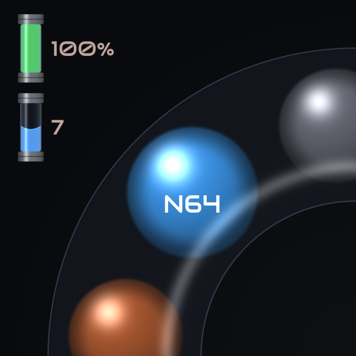
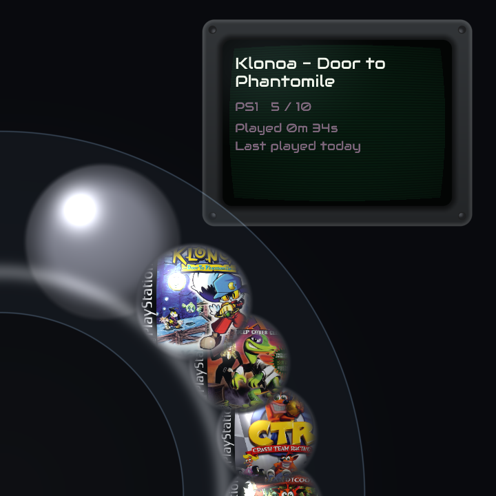
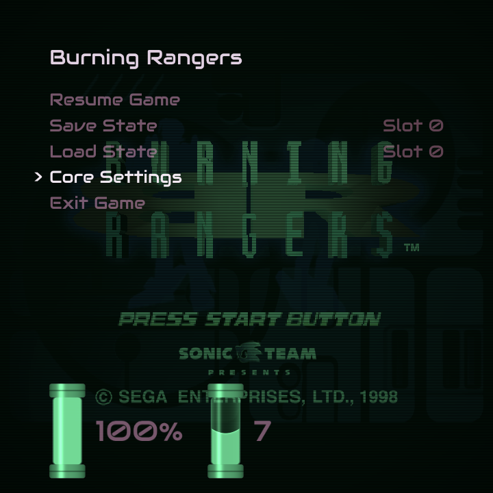

# MIROKI

A standalone custom firmware for the Anbernic RG Rotate (Unisoc T618,
ums512). It boots from the internal eMMC, with no SD card needed, straight
into RetroArch with `ramen`, a menu built for the swivel screen that puts the
games first. It covers the 5th generation: N64 (mupen64plus), PlayStation
(PCSX ReARMed) and Saturn (YabaSanshiro).

The boot chain is a rebuilt Unisoc SPL and a small EL3 monitor of our own,
then a mainline-based kernel and a squashfs root. The stock firmware's
secure world and u-boot are not used.

### AI Disclaimer

Claude Code was used here, like a bunch.

## Previews

<table>
  <tr>
    <th width="50%">Systems</th>
    <th width="50%">Games</th>
  </tr>
  <tr>
    <td></td>
    <td></td>
  </tr>
  <tr>
    <th colspan="2">In-Game Menu</th>
  </tr>
  <tr>
    <td colspan="2" align="center"></td>
  </tr>
</table>

## Building

### Host

Ubuntu 24.04 or a derivative, on x86_64. The kernel, the boot chain and the
rootfs are cross-built with Ubuntu's AArch64 toolchain. RetroArch links
against Ubuntu's arm64 libraries through multiarch: arm64 packages come from
`ports.ubuntu.com`, so add that as an arm64-only apt source first if your
system has none.

```sh
sudo dpkg --add-architecture arm64
sudo apt update
sudo apt install build-essential gcc-aarch64-linux-gnu g++-aarch64-linux-gnu \
    bc bison flex libssl-dev kmod python3 rsync squashfs-tools \
    autoconf automake libtool pkgconf pkgconf:arm64 \
    libasound2-dev:arm64 libdrm-dev:arm64 libegl-dev:arm64 \
    libgles-dev:arm64 libgbm-dev:arm64 libudev-dev:arm64 \
    libxkbcommon-dev:arm64 zlib1g-dev:arm64
```

### Sources

The components are git submodules under `ext/`:

```sh
git clone --recurse-submodules <this repository>
cd rg-rotate
```

In an existing checkout, `git submodule update --init --recursive` fetches
them. PCSX ReARMed needs its own nested submodules, which `--recursive`
covers.

### Build

```sh
make
```

builds everything into `build/cfw`. Each step is also a target of its own,
which runs one script from `tools/`:

| Target | Output | eMMC partition |
|---|---|---|
| `make spl` | `build/cfw/splloader.img` | `splloader` |
| `make boot` | `build/cfw/boot.img` | `boot` |
| `make retroarch` | `build/cfw/retroarch/` | |
| `make cores` | `build/cfw/cores/` | |
| `make rootfs` | `build/cfw/rootfs.squashfs` | `rootfs` |

`make rootfs` packs what the others built: the kernel modules from
`make boot`, RetroArch and the cores. After a kernel change, rebuild both
`boot` and `rootfs`, so the modules match the kernel.

`make clean` removes `build/`. `make distclean` also cleans the builds that
happen inside the submodules (the kernel, busybox, RetroArch, the cores and
the SPL). `JOBS=n` limits parallelism.

## Flashing

***INSTALLING MIROKI WILL OBLITERATE ANDROID FROM YOUR RG ROTATE AND DOES NOT SUPPORT DUAL BOOTING!!!***

***SERIOUSLY, YOU HAVE BEEN WARNED!!!***

Flashing uses the BootROM's download mode and `tools/spd_dump`, with the
device's download stubs (`fdl1-dl.bin`, `fdl2-dl.bin`) next to it. To enter
download mode, hold the Home/Back combo button while plugging in USB; the
host should then see a `1782:4d00` device.

**Writing the SPL or the partition table can brick the device, short of
BootROM recovery.** Keep a full backup of the stock firmware.

The first flash repartitions the eMMC user area to MIROKI's layout
(`tools/cfw-emmc-partitions.xml`) and writes all three images:

```sh
cd tools
./spd_dump --wait 300 keep_charge 1 \
  fdl fdl1-dl.bin 0x5500 \
  fdl fdl2-dl.bin 0x9EFFFE00 \
  exec \
  repartition cfw-emmc-partitions.xml \
  write_part splloader ../build/cfw/splloader.img \
  write_part boot ../build/cfw/boot.img \
  write_part rootfs ../build/cfw/rootfs.squashfs \
  poweroff
```

After that, flash only what changed: leave out `repartition`, and write just
the partitions you rebuilt. `exec` must come after the two `fdl` loads and
before any write, and `poweroff` comes last. `FDL2: incompatible partition` is
harmless.

## First boot

On the first boot the `data` partition is formatted as exFAT. It holds
everything that changes: ROMs, saves, states and RetroArch's settings.

- ROMs go in `roms/n64`, `roms/psx` and `roms/saturn`.
- BIOS files go in `bios`. The Saturn core needs one of `saturn_bios.bin`,
  `sega_101.bin` or `mpr-17933.bin`; the PlayStation core has a built-in
  BIOS and can use a real one.
- Boxart optionally goes under `roms/<system>/boxart` with each file matching
  the name of its corresponding game, minus its extension. Accepted formats
  are `.png` and `.jpg/.jpeg`.
- Extra libretro cores can go in `cores`, as aarch64 Linux builds named
  `<name>_libretro.so`. Each becomes a system that reads `roms/<name>`; with
  a matching `<name>_libretro.info` beside it, it also reads
  `roms/<systemid>`, the `systemid` from that file. Make those folders
  yourself. A core named like a built-in one (`pcsx_rearmed_libretro.so`),
  or whose name or `systemid` is `n64`, `psx` or `saturn`, replaces that
  built-in core. Cores must render in software or through GLES, and need
  only the libraries already on the device.

An SD card is optional. If one is in (exFAT or FAT), its top-level `bios`,
`cores` and `roms` folders are read alongside the ones on `data`, laid out
the same way; where both have the same BIOS or core file, `data`'s is used.
Saves, states and settings always stay on `data`.

Press Start in the system carousel for Storage Mode: the device shares
`data` with the computer as a USB drive and unmounts the SD card, so the card
can be taken out or swapped. It leaves Storage Mode when the computer ejects
the drive (or on Start again), then mounts whatever card is in and reads
everything again.

## Controls

| Input | Action |
|---|---|
| AUX | Open the menu (also in game) |
| Mode + R1 / L1 | Save / load state |
| Mode + R2 | Fast-forward on/off |
| Mode + Right / Left | Next / previous state slot |
| Start, in the carousel | Storage Mode |
| Volume keys | Volume |
| Mode + volume keys | Screen brightness |
| Power, short press, or closing the swivel | Sleep |
| Power, held for 2 s | Power off (with a short buzz) |

## Console

The device side of USB also carries a serial console. On the computer:

```sh
sudo modprobe cdc_acm
picocom -b 115200 /dev/ttyACM0
```

If ModemManager runs on the computer, it probes the port as a modem and its
AT commands end up as garbage at the device's shell; stop it from claiming
the port with a udev rule.

## Layout

| Path | What |
|---|---|
| `ext/boot/spl` | The SPL and the EL3 monitor (PSCI) |
| `ext/boot/linux` | The kernel |
| `ext/retroarch/` | RetroArch and the three cores |
| `ext/system/` | busybox, exfatprogs, libudev-zero, the Mali kernel driver |
| `system/` | MIROKI's own code: the initramfs, the rootfs files, ramen, the input daemon, small audio tools, prebuilt firmware and GPU blobs |
| `tools/` | The build scripts, the kernel config, the partition layout and `spd_dump` |
